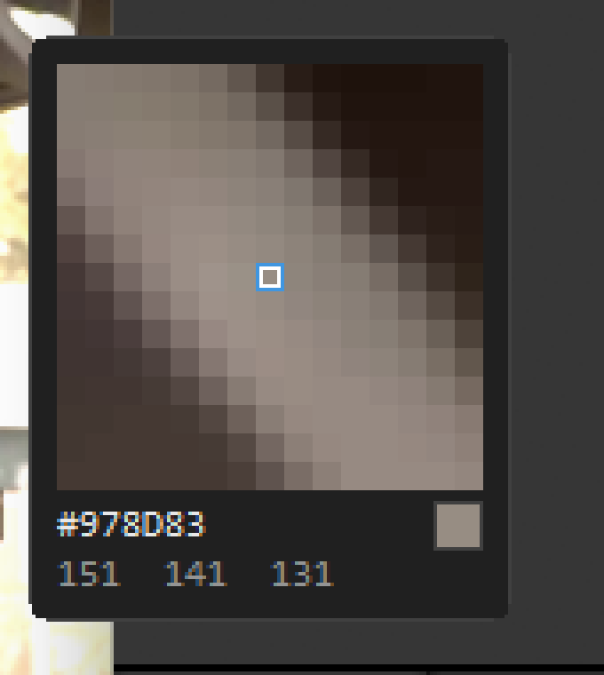

# 取色器（Eyedropper / Screen Color Picker）调研

> 目标：给 KairosEngine 编辑器的颜色字段补上真正的"吸管"能力——今天点击只弹提示。
> 本文所有非显然结论都附一手来源（crate 源码 / 官方文档 / 规范）；**未核实**的条目显式标注。
> 调研日期：2026-11-20。仓库版本：`egui 0.35.0` / `egui-winit 0.35.0` / `egui-wgpu 0.35.0` / `wgpu 29.0.3` / `winit 0.30.13`（`Cargo.lock` 实测）。
> **实现更新（2026-11-20）**：功能已落地，最终选择**桌面级取色（Windows 先行）**，不是 §5 推荐的帧回读；原因、契约与踩坑见 §8。

---

## 0. 结论摘要

1. **egui 没有任何吸管/屏幕取色能力**，也没有相关 issue/PR（在 `emilk/egui` 搜 `eyedropper`、`"eye dropper"` 命中 0 条）。egui 只提供"**本视口**下一帧截图"的 `ViewportCommand::Screenshot`（结果以 `Event::Screenshot` 回灌），取色逻辑要宿主自己实现。
2. **不要直接读 swapchain**：wgpu 只保证 surface 支持 `RENDER_ATTACHMENT`，`COPY_SRC` 不保证；egui-wgpu 自己就是因为这一点才先渲染到离屏纹理再拷贝。
3. **推荐**：引擎内 **GPU 回读**（离屏 `Rgba8Unorm` + `COPY_SRC` → 1×1 `copy_texture_to_buffer` → `map_async`），配一个宿主侧 `ColorSampler` trait 注入到 widget 层。首版只支持**编辑器窗口内**取色，跨窗口/桌面级取色留作第二阶段（`xcap`，feature gate）。
4. **明确不推荐**：`captrs`（AGPL-3.0 + 2020 年停更）、`screenshots`/`screen-capture`（已弃用，跳转 xcap）、在 widget 层写 per-platform FFI、依赖 surface 的 `COPY_SRC`。

---

## 1. 现状（仓库事实）

### 1.1 已经有的

| 位置 | 事实 |
|---|---|
| `kairos_editor_widgets/src/color_picker.rs:305` `:310` | 两个稳定 id：`color_eye_id(field)`（字段右侧吸管槽）、`color_picker_eye_id(field)`（浮窗左上吸管）。 |
| 同上 `:565-572` | 字段吸管：`Sense::hover()`，`on_hover_text("Screen color picking is not available yet; …")`——**只 hover，不可点**。 |
| 同上 `:1613-1642` | 浮窗吸管：同样是 `Sense::hover()` + 同一句提示。 |
| 同上 `:653-668`、`:1622-1638` | 图标由 `style.eyedropper_icon`（`Preferences/Textures/color_picker/eyedropper.png`）绘制，按皮肤 tint。 |
| `kairos_color/src/linear.rs:269` | `ColorUsage.eyedropper: bool`——字段级策略已经能"关掉吸管"（`without_eyedropper()`，`:308`）。 |
| `docs/plan/editor-ui-architecture/preferences-panel.md:184` | 设计文档自述：「当前宿主没有屏幕采样，点击只给提示；hex 与 Swatches 是可用替代」。 |
| 同上 `:288` | 已知问题 8：「`egui_winit` 的 screenshot 请求目前被宿主忽略（没有 framebuffer readback）……需要宿主把 screenshot 结果回灌为 `egui::Event::Screenshot`，或引擎暴露颜色附件读回」。 |

### 1.2 渲染路径（决定读回点）

| 位置 | 事实 |
|---|---|
| `kairos_graphics/src/render_pipeline.rs:254-263` | `SurfaceConfiguration { usage: TextureUsages::RENDER_ATTACHMENT, … }`——**只有 RENDER_ATTACHMENT，没有 COPY_SRC**。 |
| 同上 `:246-250` | 优先选 `TextureFormat::Rgba8Unorm`，否则用 `surface_caps.formats[0]`（通常 `Bgra8UnormSrgb`）——**不是 sRGB 格式**。 |
| 同上 `:321-343` | `get_current_texture()` 的 view 直接塞进 `internal_texture_views[FrameBufferColorAttachment]`——**场景直接画到 swapchain**，没有离屏合成 + blit。 |
| 同上 `:941-943` | egui 与场景在**同一个 render pass** 里画（`egui_renderer.render(&mut render_pass, …)`），没有中间合成纹理。 |
| `kairos_editor_app/src/host.rs:74-112` | egui 命令：一个 pass，绑 `InternalAttachmentId::FrameBufferColorAttachment`，`LoadClear` + `Store`，然后 `draw_egui`。 |
| `kairos_graphics/src/attachment.rs:6-9`、`:27-35` | `InternalAttachmentId` 只有 Color/Depth 两个；`AttachmentFormat` 已含 `RG11B10UFloat`（`:33`、`:79`）——**浮点目标今天就能申请**，HDR 取色有现成落点。 |
| `kairos_editor_app/src/host.rs:187-200` | 调 `egui_winit::process_viewport_commands(...)`，把 `actions_requested` 直接丢掉并 `debug!("ignored viewport actions: …")`——**这里正是 `ViewportCommand::Screenshot` 的出口**。 |
| `kairos_editor_app/src/host.rs:203-214` | 用 `full_output.pixels_per_point` 做 tessellation；`ScreenDescriptor { size_in_pixels, pixels_per_point }`。 |
| `kairos_engine/src/runtime.rs:101-132` | `Layer` trait：`window_created` / `window_event` / `render(&mut Engine, &Window, [u32;2], &mut Vec<GraphicsCommand>) -> FrameOutput`；`:84-92` `FrameOutput` 只有 `close_requested` / `repaint_delay`。 |

**推论**：今天没有任何 CPU 可见的帧副本；`Layer` 也拿不到 `Device/Queue`。要在引擎内取色，必须（a）新增离屏颜色目标，或（b）给 surface 加 `COPY_SRC`（§3.2 说明为何不可靠），并且（c）给 `Layer` 或 `Engine` 开一个读回入口。

---

## 2. 候选方案对比

| 方案 | 平台覆盖 | 能力 | 依赖与许可 | 采样频率 | 风险 |
|---|---|---|---|---|---|
| **A. 引擎内 GPU 回读**（离屏 `Rgba8Unorm` + `COPY_SRC`，1×1 拷贝） | 全平台（wgpu 支持面） | 只能采**本进程渲染的内容**（编辑器窗口内）；像素精确、不受窗口遮挡影响；HDR 需另开 float 目标 | 0 新依赖（wgpu 已有） | 单帧 1 次 1×1 拷贝；拖拽 30–60 Hz 可接受（每帧 ≤ 256 B 对齐后 256 B） | 需要改 render graph 末节点；`map_async` 有 1–2 帧延迟；**采不到别的窗口** |
| **B. `egui::ViewportCommand::Screenshot`** 现成通路 | 全平台 | 语义同 A，但是**整屏 ColorImage**（宽×高×4 B）；取 1 px 也要整帧拷贝 + 整帧分配 | 0 新依赖 | 每请求 1 帧全图（1080p ≈ 8 MB） | egui-wgpu 的 `capture.rs` 只支持 `Rgba8Unorm`/`Bgra8Unorm`；会把 **UI 自身一起采进去**（吸到浮窗） |
| **C. `xcap`**（桌面级截屏） | Windows / macOS / Linux（X11、Wayland，crate 描述自述） | **跨窗口、跨应用**取任意像素；Wayland 受限（§3.5） | `xcap 0.9.10`（2026-11-09），**Apache-2.0** | 每次抓一个 monitor 全帧（数 MB），不适合 60 Hz | 需屏幕录制权限（macOS TCC / Wayland portal）；Wayland 无全局光标位置 |
| **D. `windows-capture`** | 仅 Windows | Windows.Graphics.Capture，帧流 | `2.0.1`（2026-08-08），**MIT** | 面向连续帧流，不是单像素 | 引入即锁死 Windows，对"取 1 px"过重 |
| **E. `scap`** | 跨平台 | 现代截屏/录制 | `0.1.0-beta.1`（2025-08-04），**MIT** | 帧级 | **beta**，API 不稳 |
| **F. `captrs`** | 跨平台 | 老牌截屏 | `0.3.1`（2020-12-04），**AGPL-3.0** | 帧级 | **AGPL 与 MIT/Apache 双许可引擎不兼容**；6 年未更新 → 排除 |
| **G. `screenshots` / `screen-capture`** | — | — | 均已**弃用**，crate 描述即 "Move to XCap" | — | 排除 |
| **H. per-platform FFI shim**（Win32 `GetPixel`/`BitBlt`、`CGDisplayCreateImage`、`XGetImage`） | 每平台各一份 | 最省依赖、单像素最快 | 0 依赖，但要自己写 unsafe + 权限 | 单像素，极快 | 4 份平台代码 + 4 套测试；且必须放宿主（widget 层要纯 egui） |

> 表中"最后更新/许可"来自 crates.io API（`/api/v1/crates/<name>` 与 `/api/v1/crates/<name>/<ver>`）实测；**传递依赖数量未逐一核实**。

---

## 3. 关键事实

### 3.1 egui 0.35 暴露了什么、没暴露什么

- **没有吸管**：`emilk/egui` 仓库搜索 `eyedropper` 与 `"eye dropper"` 均为 0 条 issue/PR（GitHub Search API，2026-11-20）。egui 的 `ColorPicker` 只是 HSV 控件，不读屏幕。
- **指针位置**：`egui::InputState::pointer`（logical points）、`ui.ctx().pointer_latest_pos()`；像素换算用 `Context::pixels_per_point()`。Kairos 在 `host.rs:203-214` 用的就是 `full_output.pixels_per_point`（`egui-winit` 从 `window.scale_factor()` 初始化，`host.rs:122-129`）。
- **截图**：`ViewportCommand::Screenshot(UserData)`——"Take a screenshot of the next frame after this. The results are returned in `Event::Screenshot`"（本机 `egui-0.35.0/src/viewport.rs:1197-1200`）。结果由集成层以 `Event::Screenshot { viewport_id, user_data, image }` 回灌（同 crate `src/data/input/event.rs:177-185`）。**0.35.0 没有 `Context::request_screenshot`**（本机源码检索 0 命中）；那是 main 分支的新回调式 API（PR #8489），升级 egui 时才需要跟着改。
- **宿主必须自己接**：`egui_winit::ActionRequested::{Screenshot, Cut, Copy, Paste}`（[lib.rs:1685-1690](https://github.com/emilk/egui/blob/main/crates/egui-winit/src/lib.rs#L1685-L1690)），`process_viewport_commands` 只是把它们**收集**进 `Vec`（[lib.rs:1692-1702](https://github.com/emilk/egui/blob/main/crates/egui-winit/src/lib.rs#L1692-L1702)）。Kairos 今天把这个 Vec 丢掉（`host.rs:195-200`）→ 所以截图请求"被忽略"。
- **光标**：`ViewportCommand::{CursorGrab(CursorGrab), CursorVisible(bool), CursorPosition(Pos2), MousePassthrough(bool)}` 都在 egui 侧有对应命令（[ViewportCommand](https://docs.rs/egui/0.35.0/egui/viewport/enum.ViewportCommand.html)）；`CursorPosition` 文档自己写着 "Will probably not work as expected!"。
- **egui 不给的东西**：没有"读取已渲染像素"的同步 API，没有跨进程/跨窗口采样，没有全局鼠标钩子。

### 3.2 wgpu 29.0.3 的回读约束

| 事实 | 来源 |
|---|---|
| surface 的 `usage` "The only usage guaranteed to be supported is `TextureUsages::RENDER_ATTACHMENT`" | [SurfaceConfiguration](https://docs.rs/wgpu-types/29.0.0/wgpu_types/struct.SurfaceConfiguration.html) / [SurfaceCapabilities.usages](https://docs.rs/wgpu/29.0.3/wgpu/struct.SurfaceCapabilities.html)（"`RENDER_ATTACHMENT` is guaranteed"） |
| `COPY_SRC` 允许纹理作为 `copy_texture_to_buffer` 的源 | [TextureUsages](https://docs.rs/wgpu/29.0.3/wgpu/struct.TextureUsages.html) |
| 行对齐常量 **256**："Buffer-texture copies must have `bytes_per_row` aligned to this number" | [COPY_BYTES_PER_ROW_ALIGNMENT](https://docs.rs/wgpu/29.0.3/wgpu/constant.COPY_BYTES_PER_ROW_ALIGNMENT.html) |
| 结构体是 `TexelCopyBufferInfo { buffer, layout: TexelCopyBufferLayout { offset, bytes_per_row, rows_per_image } }`；官方例子 `32x16 RGBA8 → 128 padded to 256` | [TexelCopyBufferLayout](https://docs.rs/wgpu/29.0.3/wgpu/struct.TexelCopyBufferLayout.html) |
| 1×1 也要按 256 对齐 → 缓冲至少 256 B（`bytes_per_row: Some(256)`） | 同上（对齐规则与尺寸无关） |
| 回读缓冲需 `MAP_READ \| COPY_DST`；`map_async` 回调在映射完成时触发 | [Buffer](https://docs.rs/wgpu/29.0.3/wgpu/struct.Buffer.html)（"map_async … waits for the GPU to finish using the buffer, and invokes callback"） |
| 阻塞等待要 `Device::poll(PollType::Wait)`："Will block if `PollType::Wait` is passed" | [Device::poll](https://docs.rs/wgpu/29.0.3/wgpu/struct.Device.html) |
| `Bgra8UnormSrgb`："Srgb-color [0, 255] converted to/from linear-color float [0, 1] in shader" → **显存里存的就是 sRGB 编码字节**，扫到缓冲不需要再转换 | [TextureFormat](https://docs.rs/wgpu/29.0.3/wgpu/enum.TextureFormat.html) |
| **surface 的 `COPY_SRC` 不可靠**：egui-wgpu 源码注释 "`wgpu::TextureUsages::COPY_SRC` is not an allowed flag for the surface texture on all platforms" → 它宁可先渲染到自己的纹理再 blit | [egui-wgpu/src/capture.rs:1-20](https://github.com/emilk/egui/blob/main/crates/egui-wgpu/src/capture.rs#L1-L20) |

**egui-wgpu 的参考实现（可直接照抄结构）**：`CaptureState` 建 `RENDER_ATTACHMENT | TEXTURE_BINDING | COPY_SRC` 的离屏纹理 → `copy_texture_to_buffer`（`bytes_per_row = align_to(w*4, 256)`）→ `map_async` → 逐行 `chunks(padded_bytes_per_row)` 去 padding → 得 `ColorImage`；同时用全屏三角形把该纹理 blit 回 surface（`texture_copy.wgsl`）。它明确只支持 `Rgba8Unorm` / `Bgra8Unorm`，BGRA 用 `[2,1,0,3]` 换序，结果是 **premultiplied** alpha（`Color32::from_rgba_premultiplied`）。

**egui-wgpu 的渲染器不暴露目标纹理**：`Renderer::new(device, surface_format, options)` 只持 pipeline / bind group，渲染时由调用方给 `RenderPass`（Kairos 在 `render_pipeline.rs:266-270`、`:941-943` 使用）。要拿目标纹理只能自己建。

### 3.3 颜色学：LDR 与 HDR

- **采样目标是"显示参考"的 sRGB 字节**：Kairos 的 surface 是 `Rgba8Unorm`（`render_pipeline.rs:246-250`），硬件不做 sRGB 编码，写进去的就是着色器输出的显示值；若落到 `Bgra8UnormSrgb` 后端，存的是 sRGB 编码字节（§3.2）。两者扫出来都应视为 **sRGB(display-referred)**。
- **转引擎值只需一步**：`Color::from_srgb8([u8;4])`（[linear.rs:104-121](KairosEngine/kairos_color/src/linear.rs)）内部走 `srgb_to_linear`（同文件 `:324-331`，标准 sRGB EOTF：`c<=0.04045 ? c/12.92 : ((c+0.055)/1.055)^2.4`）。`Color` 本身是 **8 字节 f16×4 线性**（`linear.rs:34-38`），alpha 是 straight（非 premultiplied）→ 从 premultiplied 结果转过来要除 alpha，或直接忽略（吸管只要 RGB）。
- **LDR 天花板**：8-bit 目标只有 0–1，HDR/自发光 >1 的能量**必然丢失**。要 HDR 吸管只能：(1) 从**场景 HDR 中间目标**读回（`AttachmentFormat::RG11B10UFloat` 已存在，`attachment.rs:33`/`:79`）；或 (2) 单独渲一张 `Rgba16Float` 取色目标。两者都要求 UI **不进**这张图。
- **Blender 的教训**：官方手册明确「The View Transform of the color management affects the color … To get consistent results, it should be set to Standard」（[Blender Manual: Eyedropper](https://docs.blender.org/manual/en/latest/interface/controls/buttons/eyedropper.html)）——吸管吸的是**显示后的颜色**，色彩管理/色调映射会污染结果。Kairos 日后若加 tone mapping，LDR 吸管必须复现同一条映射链，否则"看到的"和"吸到的"不一致。

### 3.4 DPI / 多显示器

- egui 坐标是 **logical points**，framebuffer 是 **physical pixels**：`physical = points * pixels_per_point`（`host.rs:203-214` 已把 `pixels_per_point` 传给 `ScreenDescriptor`）。
- 多显示器下每块屏 scale 可能不同，egui 的 `pixels_per_point` 是**每视口一个**（`host.rs:122-129` 用 `window.scale_factor()` 初始化，随 `ScaleFactorChanged` 更新）。
- 桌面级采样必须自己做 **global physical → monitor-local physical** 映射（各显示器 origin + scale 不同）。

### 3.5 输入捕获 / 平台约束（winit 0.30.13）

| 能力 | 事实 | 来源 |
|---|---|---|
| `CursorGrabMode::Confined` | **macOS 未实现，恒返回 `NotSupported`**；iOS/Android/Web 亦然 | [CursorGrabMode](https://docs.rs/winit/0.30.13/winit/window/enum.CursorGrabMode.html) |
| `CursorGrabMode::Locked` | **X11 未实现，恒返回 `NotSupported`**；iOS/Android 亦然 | 同上 |
| 隐藏光标 | grab **不保证**隐藏："There's no guarantee that the cursor will be hidden. You should hide it by yourself" → 需 `set_cursor_visible(false)`（egui 侧 `ViewportCommand::CursorVisible`） | 同上 |
| `Window::set_cursor_position` | Wayland 要求先 `Locked`；iOS/Android/Web/Orbital 恒 `NotSupported` | [Window](https://docs.rs/winit/0.30.13/winit/window/struct.Window.html) |
| 拖到窗口外仍收 `CursorMoved` | **未核实**：winit 未公开"鼠标捕获"API；Windows 语义上需要 Win32 `SetCapture`（[MS 文档](https://learn.microsoft.com/en-us/windows/win32/api/winuser/nf-winuser-setcapture)），X11 需要 `XGrabPointer`。**winit 是否在按键期间自动捕获，需一次实机 spike 确认** | — |
| 全局鼠标钩子 | winit 不提供；Wayland 无全局坐标 | — |

**Wayland 的硬限制**：客户端拿不到窗口外的指针位置，也拿不到其它窗口的像素；桌面级取色只能走 `org.freedesktop.portal.ScreenCast`（+ PipeWire 帧流），且需要用户在 portal 对话框授权一次会话。**没有 ScreenCast portal 就没有跨窗口取色**——协议层限制。

---

## 4. 竞品做法（可核实部分）

### Godot —— 直接问 DisplayServer 要一个像素
`scene/gui/color_picker.cpp:243`：`Color c = DisplayServer::get_singleton()->screen_get_pixel(ofs);`（[源码](https://github.com/godotengine/godot/blob/master/scene/gui/color_picker.cpp#L243)）。`DisplayServer.screen_get_pixel(position: Vector2i)` 是**一等 API**（[类参考](https://docs.godotengine.org/en/stable/classes/class_displayserver.html)），各平台后端各写一份（具体后端实现未逐一核对）。
→ 可抄的点：**把"取一个屏幕像素"做成平台抽象层的一个方法**，而不是让控件自己想办法；取色由 `ColorPicker` 的 picking 状态 + 鼠标移动驱动，Esc 取消（`color_picker.cpp` 内有 `pre_picking_color` 还原逻辑，`:1369-1380`、`:1632`）。

### Blender —— 窗口内任意位置，吸"显示后"的颜色
官方手册：eyedropper "allows you to sample from anywhere in the Blender window"，且 **View Transform 会影响取到的颜色**，建议设为 Standard 才一致（[手册](https://docs.blender.org/manual/en/latest/interface/controls/buttons/eyedropper.html)）。
→ 两个结论：(1) Blender 只保证**应用窗口内**（不是整个桌面）；(2) 吸的是**显示参考**结果，色彩管理会污染取色。
（Blender 具体走哪条 GPU readback 路径——`editors/screen/eyedropper.cc` 里的 frontbuffer 读回——**本次未取到源码页**，待核实。）

### Unity —— 全屏任意像素，click → click（官方文档已核实）
Unity 手册写明：点吸管，然后「Click on a pixel to select its color. **You can use any pixel, in or outside of the Unity Editor.**」（[Unity Manual: Select colors and color gradients](https://docs.unity3d.com/6000.3/Documentation/Manual/InspectorColorPicker.html)）。
→ 两条可确认的产品事实：(1) 采样范围是**整个桌面**，不只是编辑器窗口——所以要的是 OS 级取像素，不是渲染帧回读；(2) 交互是**先点吸管进入拾取态，再点一次取色**，不是按住拖拽。
→ 未核实：HDR 字段被吸管处理时的具体规则、拾取态下的取消键；这两点实现前可从本机 Tuanjie 1.8.4 的 `UnityEditor.CoreModule.dll` 反编译核实（仓库已有同样先例，见 `docs/research/unity-editor-chrome/`）。

### Unreal —— 未核实
`SColorPicker` 的吸管实现属 Epic 私有仓库（需 EULA 账号），无公开一手源码可引；不作断言。

---

## 5. 推荐方案

### 5.1 主推：引擎内 GPU 回读 + 宿主注入的采样服务（两阶段）

**阶段 1（MVP）——"窗口内取色"**
1. `kairos_graphics`：新增 `FrameCapture`（照抄 egui-wgpu `CaptureState` 的形状）：离屏 `Rgba8Unorm`，usage = `RENDER_ATTACHMENT | TEXTURE_BINDING | COPY_SRC`；场景 pass 指向它，再用全屏三角形 blit 到 surface；采样时只对**目标像素**做 `copy_texture_to_buffer`（`Extent3d{1,1,1}`，`bytes_per_row: Some(256)`，buffer 256 B）。
2. `kairos_engine::runtime::Layer`：加一个可选钩子（或让 `Engine` 暴露 graphics 访问器），把"本帧读回结果"交给 layer；`FrameOutput` 增加 `sampling` 字段（或请求走 `World` 资源，loop 每帧检查）。
3. `kairos_editor_app/src/host.rs`：**接住 `actions_requested` 里的 `ActionRequested::Screenshot`**（今天在 `:195-200` 被丢弃），或走自建通道；在 `run_ui` 之前把 `[u8;4]` 塞进 `egui::Context::data_mut()`。
4. `kairos_editor_widgets/src/color_picker.rs`：把 `:567` / `:1616` 的 `Sense::hover()` 改成 `Sense::click_and_drag()`；按下 → picking 态（`ctx.set_cursor_icon(Crosshair)` + `ViewportCommand::CursorVisible(false)`）；移动 → 读宿主采样结果；抬起 → 写回 `value`（`Color::from_srgb8`）；Esc → 还原。widget 层只认一个 **trait**，不认 wgpu：

~~~rust
// 建议放在 kairos_editor_widgets::color_picker（或 kairos_color），纯数据、无 wgpu
pub trait ColorSampler: Send + Sync {
    /// 逻辑点（egui points，窗口坐标）→ sRGB8。None = 本帧还没结果 / 不可采。
    fn sample(&self, at: egui::Pos2) -> Option<[u8; 4]>;
    /// 宿主是否具备采样能力（Wayland / 未接线时返回 false）。
    fn available(&self) -> bool { true }
}
~~~
宿主通过 `egui::Context::data_mut()`（或 `ColorPickerStyle` 旁的一个 `Arc<dyn ColorSampler>` 注入点）交给 widget。**这样 widget crate 仍然零 wgpu 依赖**（与 `kairos_editor_widgets/Cargo.toml` 现状一致）。

**阶段 2——"桌面级取色"（可选，feature gate）**：`xcap`（Apache-2.0，0.9.10，2026-11 仍在维护）抓鼠标所在 monitor 一帧，按物理坐标取像素；只在 Windows / macOS / X11 开启，Wayland 走 portal 或直接禁用并提示。

### 5.2 备选
- **B. 直接用 `ViewportCommand::Screenshot`**：最省事，但整帧 `ColorImage`（1080p ≈ 8 MB/次）+ 会把 UI 一起采进来。**只适合一次性整屏快照**，不适合拖拽连续采样。
- **H. per-platform shim**：只有当"必须采别的应用窗口"且不肯引入 `xcap` 时才考虑；4 份 unsafe 代码，维护成本最高。

### 5.3 明确不推荐
- **`captrs`**：AGPL-3.0（crates.io 实测）+ 2020-12 后未更新 → 与 MIT/Apache 双许可引擎不兼容。
- **`screenshots` / `screen-capture`**：crate 描述即 "Move to XCap"，已弃用。
- **`scap 0.1.0-beta.1`**：beta，API 不稳，不适合作为唯一通路。
- **`windows-capture`**：MIT 但仅 Windows，且是帧流 API，为"取 1 px"引入过重。
- **直接给 surface 加 `COPY_SRC` 就当万事大吉**：wgpu 只保证 `RENDER_ATTACHMENT`；egui-wgpu 已用离屏纹理绕开。
- **在 widget 层写平台 FFI**：破坏 `kairos_editor_widgets` 的"纯 egui"边界。

---

## 6. 对 KairosEngine 的落点（crate / 文件）

| 工作项 | 落点 | 说明 |
|---|---|---|
| 离屏捕获 + 1×1 回读 | `kairos_graphics/src/render_pipeline.rs`（新 `FrameCapture`，可新建 `src/capture.rs`） | 复用 `internal_texture_views` 机制；`Attachment::from_internal_id` 已有形状（`attachment.rs:62-70`） |
| 读回结果跨层传递 | `kairos_engine/src/runtime.rs`（`Layer` / `FrameOutput`） | 今天 `FrameOutput` 只有两个字段（`:84-92`），加 `sampling` 或 `SampleRequest` 最小侵入 |
| 截图请求接线 | `kairos_editor_app/src/host.rs:187-200` | 把 `actions_requested` 从"丢弃"改成"处理 `Screenshot`"；这是 egui 侧唯一官方入口 |
| 采样服务 trait | `kairos_editor_widgets/src/color_picker.rs`（trait 定义）+ `kairos_color`（`[u8;4]→Color` 已有 `from_srgb8`） | widget 只依赖 trait，不依赖 wgpu |
| 吸管交互 | `kairos_editor_widgets/src/color_picker.rs:565-572`、`:1613-1642` | `Sense::hover()` → `click_and_drag()`；picking 态 + Crosshair + Esc 还原 |
| HDR 支持 | `kairos_graphics/src/attachment.rs:33`/`:79`（`RG11B10UFloat` 已存在） | 需要时给取色单独开 float 目标；LDR 路径不动 |
| 文档 | `docs/plan/editor-ui-architecture/preferences-panel.md:184`、`:288` | 实现后这两处"没有屏幕采样"的说法要一起改 |

**widget 层需要宿主提供的最小契约**（建议补进 `docs/adr/0013-color-value-and-usage.md` 或新 ADR）：
1. `sample(at: Pos2) -> Option<[u8;4]>`：逻辑点 → sRGB 字节；`None` 表示"不可用/无结果"（widget 据此显示禁用态而不是错误提示）。
2. `available() -> bool`：宿主是否具备采样能力（Wayland / 未接线返回 false → 保留今天那句"不可用"提示）。
3. 可选 `begin()/end()`：让宿主在整个拖拽期间只捕获一次、按帧回读，避免每次 mousemove 都新建 buffer。

---

## 7. 参考链接

**仓库内**
- `KairosEngine/kairos_editor_widgets/src/color_picker.rs`（`:305` `:310` `:565-572` `:1613-1642`）
- `KairosEngine/kairos_graphics/src/render_pipeline.rs`（`:246-263` `:321-343` `:941-943`）
- `KairosEngine/kairos_graphics/src/attachment.rs`（`:6-9` `:27-35` `:73-82`）
- `KairosEngine/kairos_editor_app/src/host.rs`（`:74-112` `:187-214`）
- `KairosEngine/kairos_engine/src/runtime.rs`（`:84-92` `:101-132`）
- `KairosEngine/kairos_color/src/linear.rs`（`:34-38` `:104-121` `:324-341`）
- `docs/plan/editor-ui-architecture/preferences-panel.md:184`、`:288`
- `docs/research/texture-encoding/wgpu-srgb-handling.md`（仓库已有的 wgpu sRGB 笔记）

**egui / egui-wgpu**
- <https://github.com/emilk/egui/blob/main/crates/egui/src/viewport.rs#L1201-L1204>
- <https://github.com/emilk/egui/blob/main/crates/egui/src/context.rs#L4572-L4583>
- <https://github.com/emilk/egui/blob/main/crates/egui-winit/src/lib.rs#L1685-L1702>
- <https://github.com/emilk/egui/blob/main/crates/egui-wgpu/src/capture.rs>
- <https://github.com/emilk/egui/pull/8489>（screenshot 回调化）
- <https://docs.rs/egui/0.35.0/egui/viewport/enum.ViewportCommand.html>

**wgpu 29**
- <https://docs.rs/wgpu/29.0.3/wgpu/struct.SurfaceCapabilities.html>
- <https://docs.rs/wgpu-types/29.0.0/wgpu_types/struct.SurfaceConfiguration.html>
- <https://docs.rs/wgpu/29.0.3/wgpu/constant.COPY_BYTES_PER_ROW_ALIGNMENT.html>
- <https://docs.rs/wgpu/29.0.3/wgpu/struct.TexelCopyBufferLayout.html>
- <https://docs.rs/wgpu/29.0.3/wgpu/struct.Buffer.html> / <https://docs.rs/wgpu/29.0.3/wgpu/struct.Device.html>
- <https://docs.rs/wgpu/29.0.3/wgpu/enum.TextureFormat.html>

**winit 0.30**
- <https://docs.rs/winit/0.30.13/winit/window/enum.CursorGrabMode.html>
- <https://docs.rs/winit/0.30.13/winit/window/struct.Window.html>

**crates**
- <https://crates.io/crates/xcap>（0.9.10，Apache-2.0，2026-11-09）
- <https://crates.io/crates/windows-capture>（2.0.1，MIT，2026-08-08）
- <https://crates.io/crates/scap>（0.1.0-beta.1，MIT，2025-08-04）
- <https://crates.io/crates/captrs>（0.3.1，AGPL-3.0，2020-12-04）
- <https://crates.io/crates/screenshots> / <https://crates.io/crates/screen-capture>（弃用 → xcap）

**竞品**
- <https://github.com/godotengine/godot/blob/master/scene/gui/color_picker.cpp#L243>
- <https://docs.godotengine.org/en/stable/classes/class_displayserver.html>（`screen_get_pixel`）
- <https://docs.blender.org/manual/en/latest/interface/controls/buttons/eyedropper.html>

**平台**
- <https://learn.microsoft.com/en-us/windows/win32/api/winuser/nf-winuser-setcapture>
- <https://flatpak.github.io/xdg-desktop-portal/docs/doc-org.freedesktop.portal.ScreenCast.html>

---
---

## 8. 落地结果（2026-11-20）

**做成了什么**

- **桌面级取色（Unity 语义）**：拾取态下 `GetCursorPos` 取屏幕物理坐标，`BitBlt` 从屏幕 DC 拷 15×15 块；单击（任意窗口之上）确认，Esc/右键取消。不依赖 framebuffer readback，也不接 egui 的 screenshot。
- **放大镜浮层**：置顶、点击穿透、无激活的 popup，GDI 画 15×15 像素约 8× 放大（中心格高亮 + 白描边）、`#RRGGBB`、RGB 与色块；跟随光标，靠近屏幕边缘自动翻面。
- **widget/host 契约**：`color_picker::eyedropper` 只暴露会话（`session`）、能力位（`set_supported`）和每帧一条 `Update { id, field, srgb, outcome }`；widget 侧零平台、零 wgpu 依赖。没有采样器的平台 `available() == false`，保留原「not available」提示。
- **HDR**：只改基色，用会话开始时捕获的曝光 `with_base` 重组（alpha 保留）；拾取期间 picker 的 Intensity 行走 base-only 刷新，不会跳。
- **桌面输入遮罩**：拾取期间宿主装 `WH_MOUSE_LL` 低层鼠标钩子，丢掉鼠标**按键和滚轮**；**移动必须放行**——系统是在投递移动事件时更新光标的，吞掉移动会把整个系统的光标冻住（实测，见下）。于是确认点击不会按到编辑器自己的标题栏按钮（缩小/放大/关闭），也不会激活别的程序或任务栏；拾取时窗口仍持有 capture，移动事件被路由到编辑器并被宿主吞掉，不进 egui。放大镜和采样都靠 `GetCursorPos`/`BitBlt`，不需要被丢掉的按键消息。钩子丢弃的事件 `GetAsyncKeyState` 也看不到，所以确认/取消的按键由钩子自己记进原子位、pick 从记录里读；钩子装不上时退回 capture + 按键状态。
- **落盘时机**：确认点击永远不会到 egui，Preferences 原本「指针抬起才写盘」的约定会漏掉这一下；widget 侧加了 `eyedropper::take_committed`（拾取结束信号，帧内一次性），`draw_color` 把它当作 `finished_edit`，落盘和普通点击一样即时。
- **落点**：`kairos_editor_widgets/src/color_picker.rs`（会话/交互 + `take_committed`）、`kairos_editor_app/src/eyedropper/{win32,unsupported}.rs`（采样 + 浮层 + 输入遮罩）、`kairos_editor_app/src/host.rs`（每帧 poll/publish、吞鼠标、停止）、`kairos_editor_component/src/panels/preferences.rs`（`take_committed` → 页面写盘）、ADR `docs/adr/0014-eyedropper-screen-sampling.md`。

**为什么不是 §5 的帧回读**

需求对齐时确认要「整个桌面可取色」（Unity 行为），帧回读只能取编辑器窗口内的像素；且 surface 的 `COPY_SRC` 不保证、场景与 egui 同 pass 直画 surface，要回读就得给帧模型加离屏目标与 blit。桌面采样虽然带平台代码，但正好落在宿主层、不碰渲染图，并且换来了跨窗口取色。

**踩到并修掉的坑**

- **不能把确认点击喂回 egui**：pick 期间吞掉的还有 `CursorMoved`，egui 的指针位置停在「吸管按钮」上；确认后若要补一个合成的 release（本想让「抬笔」把样式写盘），这个 release 会落在旧位置，把吸管按钮再点一次 → 立刻开始新的 pick（日志实测 `Committed session 1` 紧接 `start session 2`）。最终做法：pick 结束后继续吞鼠标事件，直到那个按键真正抬起；写盘后来改由 widget 上报拾取结束（`take_committed`）完成，不再依赖这个 release。
- **停不下来的 pick**：字段所在面板在拾取中被关掉时没人消费 update，会话会一直存活。会话带 60 s 超时，主机据此停止采样。
- **GDI 浮层不能进采样区**：光标快速移进上一帧浮层时，先把浮层隐藏再 `BitBlt`，避免放大镜拍到自己。
- **`SetCapture` 管不到自己窗口的标题栏**：鼠标捕获只保证别的窗口收不到点击，**捕获窗口自己的非客户区照常处理**，所以 pick 中按标题栏的关闭/最小化按钮真的会生效。要屏蔽就得在系统把输入变成点击之前拦截，即低层鼠标钩子（`WH_MOUSE_LL`）。
- **钩子丢弃的事件连 `GetAsyncKeyState` 都看不到**：第一版遮罩只打算吞输入、继续轮询按键状态来确认，实机测试发现拾取中按标题栏关闭按钮时窗口没关（遮罩生效）但 pick 也不结束——低层钩子返回非 0 后事件不进异步键状态表。改成钩子在丢弃前把左/右键按下记进原子位，`poll` 从记录里读确认/取消；`GetAsyncKeyState` 只留给键盘 Esc 和钩子装失败的退路。
- **吞掉 `WM_MOUSEMOVE` 会冻住系统光标**：第一版把悬停移动也一起丢掉，用户点吸管后光标完全动不了。自动化第一次没抓到，因为测试用 `SetCursorPos` 直接改坐标、绕过了输入事件；之后用 `mouse_event(MOUSEEVENTF_MOVE)` 发相对移动才复现（旧实现 `GetCursorPos` 读数不变，放行移动后正常）。结论：遮罩只吞按键/滚轮，移动必须放行。

**尚未做**

- macOS（`NSColorSampler` 或 `CGDisplayCreateImageForRect`，需屏幕录制权限）、Linux（X11 `XGetImage`；Wayland 只能走 ScreenCast portal）。
- 全屏取色时的 HDR：LDR 屏幕采样拿不到 >1 的数值，需要场景 float 目标，单独立项。
- 放大镜当前是 GDI 自绘，未接入 `ColorPickerStyle` 皮肤；外观 token 化留作后续。
- 拾取期间的键盘遮罩：现在只遮鼠标；`Alt+F4`、任务栏缩略图的关闭按钮不是桌面鼠标事件，仍可用。需要完全模态时另做（例如暂时禁用系统菜单），但别遮 `Alt+Tab`/Win 键，否则会把用户困住。