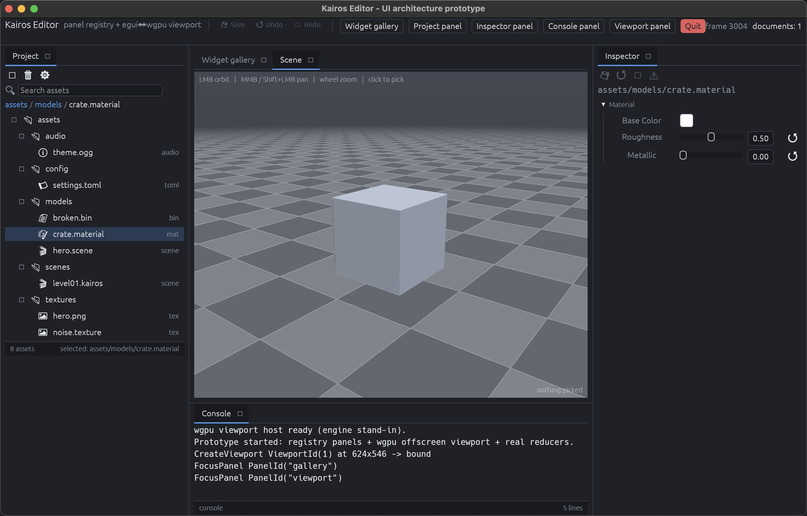
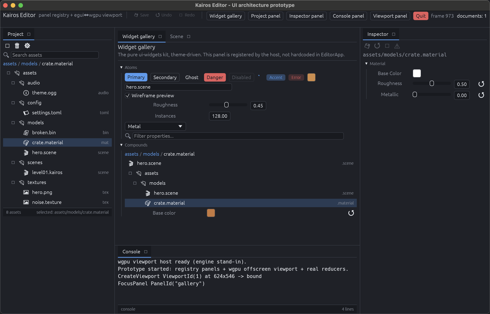

# kairos_editor UI 架构原型（throwaway code，production-shaped architecture）

> **状态**：一次性设计验证原型，**不是生产代码**。独立 `[workspace]`，不进主 workspace 构建。
> **但代码形状按最终编辑器来写**：面板是 `Panel trait + PanelRegistry + PanelHost`（`EditorApp` 里没有
> 任何一个面板字段），3D 视口是真的 offscreen wgpu render target + egui texture，而不是占位符。
> 目的是让这个原型能直接指导 `kairos_editor_app / kairos_editor_core / kairos_editor_ui /
> kairos_editor_widgets / kairos_editor_docking` 的实现（迁移表见
> [panel-viewport-design.md](../../docs/plan/editor-ui-architecture/panel-viewport-design.md) §6）。
>
> 依赖：`egui 0.35` + `eframe 0.35`（仅作为 throwaway window backend）+ `egui-wgpu 0.35` + `wgpu 29`（版本均 pin）。
> 相关：`docs/adr/0008-editor-ui-architecture.md`、`docs/adr/0009-editor-panel-host-and-viewport.md`、
> `docs/plan/editor-ui-architecture/`。日期：2026-10-30 初版；2026-11-09 面板/视口重构；2026-11-10 可读性重构（`panel/`、`app/` 模块拆分 + 架构导读）。
>
> **先读**：[docs/architecture-tour.md](docs/architecture-tour.md) —— 一页回答「面板在哪里被画」、一帧的绘制阶段、交互/消息链路，以及 7 张架构图。
> 本 README 是证据/清单；tour 是导读。

---

## 0. TL;DR

- **五个 crate、一个 workspace、126 个测试（125 个 headless + 1 doctest）、0 warning，全部离线可跑。**
- **`cargo run` 打开真实窗口**：Project / Inspector / Console / **真实 3D Scene 视口** / Widget gallery 五个面板，
  由 registry 注册、四槽 PanelHost 停靠、tab bar 切换；点击/拖拽/slider/Save/Quit 都走
  `UiOut(Action) -> reducer -> Effect -> host` 真实链路。
- **面板绘制只有一个入口**：`PanelHost::draw`（`editor-components/src/panel/host.rs`）→ `draw_slot` →
  `draw_panel_body` → `Panel::draw`；app shell 从不直接调用任何具体面板。
- **面板不写在 EditorApp**：`EditorApp` 只有 `core / panels / host / ui_out / frame_count` 五个字段；新增面板 =
  实现 `Panel` + 在组合根 `registry.register(kind, slot, factory)` 一行。Gallery 面板就是 host crate
  里注册的，`editor-core` 完全不知道它的存在。
- **`PanelId` 是稳定字符串**（`PanelId("gallery")`），不是核心 enum：打开/焦点只是数据，加面板不改 core。
- **egui ↔ wgpu 视口**：引擎/宿主把场景渲染到 offscreen 纹理，再注册成 `egui::TextureId`；UI 层只拿
  `TextureId` 画图，**看不到 wgpu 类型**（cargo 边界强制）。交互（orbit/pan/zoom/click pick）走
  `ViewportAction -> reducer -> Effect -> ViewportHost`，相机真值在 host，不在 store。
- **显式帧阶段**：`RenderViewports -> BuildUi -> dispatch -> execute effects -> present`，一帧延迟是
  契约而不是巧合（与真实引擎"Engine::update 在 UI 之前"一致）。

| 主界面（Project / Scene 3D / Inspector / Console） | Widget gallery（host 注册的面板） |
|---|---|
|  |  |

> 截图来自 2026-11-09 本机运行（macOS arm64，窗口 1280x820）。3D 视口内容是 `editor-viewport`
> 的 raymarch demo 场景（棋盘地面 + cube），用于验证 egui/wgpu/输入链路，不是引擎渲染器。

---

## 1. 这一版原型证明了什么

1. **面板架构可扩展，且不污染中心文件**：`Panel trait + PanelRegistry + PanelHost` 在真实窗口里跑通；
   `EditorApp` 没有任何 `ProjectPanel/InspectorPanel` 字段；新增/关闭/聚焦面板只改 `LayoutState`（core 数据）。
2. **widget 层仍然无领域**：`ui-widgets` 只依赖 egui（tests/purity.rs 扫描）；面板在 `editor-components` 里
   做 `state -> props` 与 `widget output -> Action` 的纯映射。
3. **egui 与 wgpu 的融合路径被跑通**：host 侧 `ViewportHost` 创建 Rgba8UnormSrgb offscreen texture、
   渲染、`register_native_texture` → `TextureId` → 面板 `painter.image`。resize 时 free+re-register，
   `TextureId` 不缓存。UI crate 无法 `use wgpu`。
4. **视口交互全链路**：LMB orbit / MMB 或 Shift+LMB pan / wheel zoom / click pick →
   `ViewportAction` → core reducer（校验 bound/ticket/尺寸）→ `Effect::{ViewportCameraInput, PickViewport}`
   → host 相机/CPU raycast → completion → `SelectionState.selected_scene_object`；拾取高亮在 shader 里呈现。
5. **视口生命周期有明确状态机**：首次 `Ensure` 发 `CreateViewport{ticket}` → `ViewportBound/Failed`；
   关闭面板 `ClosePanel` 触发 `DestroyViewport`；bind 中 resize 会在 completion 后 replay；
   stale ticket 被 reducer 忽略（11 个 viewport_flow 测试）。
6. **显式帧阶段**：`render_viewports() -> build_ui() -> pump()` 三个函数分别对应
   RenderViewports / BuildUi / dispatch+execute effects；多 pass、一帧延迟、effect 预算都在这里收口。
7. **状态归属可执行**：core 只存 `ViewportInfo{size,bound,pending_*}`；相机/GPU 在 host；控制台日志是
   host ring buffer，`ConsolePanel` 只读快照，不再 `pop` 消费历史。
8. **命令系统接入工具栏**：顶栏 Save/Undo/Redo 的 enabled 与 dispatch 来自 `CommandRegistry`
   （组件内工具栏仍直接发 Action，是已知缺口，见 §8）。

## 2. 分层与数据流

```text
+--------------------------- editor-core-prototype ---------------------------+
| EditorState { project, selection, documents, layout, viewports, modal, ... }|
| PanelId(str) / ViewportId / SceneObjectId        （身份是数据，不是中心 enum）|
| pure reducers (&mut state, Action) -> Vec<Effect>; CommandRegistry           |
+----------------------------------------------------------------------------+
              ^ Action (plain data)                  | Effect (plain data)
              |                                      v
+----------------------- editor-components-prototype -----------------------+
| Frame<'a> { state, host: &dyn HostView }   UiOut { actions: Vec<Action> }  |
| Panel trait / PanelInstanceId / DockSlot / PanelRegistry / PanelHost        |
| panels: Project, Inspector, Console, Viewport(Scene)                        |
|   -> ui-widgets (pure egui)     -> UiOut(Action)                            |
+----------------------------------------------------------------------------+
              ^ egui::TextureId / log lines (HostView)   | UiOut
              |                                          v
+--------------------------- editor-app-prototype ---------------------------+
| EditorApp = composition root: core + PanelHost + HostState + UiOut         |
| frame phases: render_viewports -> build_ui -> pump(dispatch+effects)       |
| hosts: HostState { ViewportHost, console log }, GalleryPanel (host-owned)   |
+----------------------------------------------------------------------------+
              | wgpu device/queue, offscreen texture, camera
              v
+------------------------- editor-viewport-prototype ------------------------+
| ViewportHost: offscreen Rgba8UnormSrgb + egui texture registration         |
| OrbitCamera (pure math) + pick (NDC ray) + raymarch WGSL demo scene        |
| no eframe / no editor-core / no editor-components dependency               |
+----------------------------------------------------------------------------+
```

**一帧的显式阶段**（`editor-app/src/app/{mod,pipeline}.rs`）：

```text
1. RenderViewports   host 按 core 的 viewport 状态渲染所有已 bound 的视口
                     （上一帧末尾应用的 camera intent 在这里生效）
2. BuildUi           top bar + PanelHost(四槽 tab/面板 body) + modal overlay
                     panels 只读 Frame、只写 UiOut
3. dispatch          UiOut -> Action -> core.dispatch -> Effect
4. execute effects   IO/GPU；completion 立即 App::complete -> 更多 Action/Effect
                     （viewport create/resize/camera/pick 都在这里执行）
5. present           eframe 把 egui 画出来；viewport/gallery 可见时 request repaint
```

> 实现细节：RenderViewports 放在 `eframe::App::logic`（每帧一次、在所有 UI pass 之前）；
> BuildUi 每个 pass 都清空 `UiOut` 重画，只有最后一 pass（`!ctx.will_discard()`）才
> dispatch + execute effects。egui 0.35 默认 `max_passes = 2`，这样多 pass 不会重复发包/重复渲染。

**为什么 UI 层看不到 wgpu**：`editor-components` 只通过 `Frame::host: &dyn HostView` 拿到
`Option<egui::TextureId>` 与控制台文本；`editor-viewport` 是 host crate 的依赖，不在 components 的
依赖图里。这条和真实编辑器 `Drawer/UI` 只能拿到 `EguiTextureHandle::id()` 是同一条契约。

## 2.5 窗口 demo：`cargo run`

```sh
cd prototypes/editor-ui
cargo run --offline    # 打开 "Kairos Editor - UI architecture prototype" 窗口
```

窗口默认 1280x820 可缩放；5 个面板由 registry 注册、四槽停靠、tab 切换，中央是真实 3D 场景视口。

| 交互 | 链路（Host event log 里可看到 effect） |
|---|---|
| 点击项目树资产行 | `SelectAsset` → reducer 改 selection/layout/loading → `LoadAsset` → completion → `SpawnPreview` |
| 双击 `*.material` | `DocumentAction::Open` → Inspector 显示 Material 属性（原型用占位内容，见 §8） |
| 拖 Roughness/Metallic slider | `SetMaterial` → dirty；Save → `SaveDocument{ticket,bytes}` → 写临时文件 → completion 清 dirty |
| 顶栏 Save / Cmd+S | 与组件工具栏同一个 reducer/effect 链路 |
| 面板按钮 / tab / `Cmd+G` | `LayoutAction::{TogglePanel, FocusPanel, ClosePanel}`；关闭 Scene 面板会发 `DestroyViewport` |
| 3D 视口：左键拖 | `ViewportAction::Orbit{radians}` → `Effect::ViewportCameraInput` → host camera → 下一帧渲染 |
| 3D 视口：中键/Shift+左键拖 | `Pan{normalized}`；滚轮 `Zoom`（+ = zoom in） |
| 3D 视口：单击 | `Pick{ndc}` → `Effect::PickViewport` → host CPU raycast → completion → 选中 cube（暖色高亮/log） |
| 窗口 resize | 面板上报新物理像素 → `Ensure` → resize effect → host 重建 texture（TextureId 变化，不缓存） |

**注意**：视口相机 intent 在帧末 effect 阶段应用，下一帧 RenderViewports 才可见 —— 这是和真实引擎
一致的 **1 帧延迟**（见 design doc §3.6 的前提表）。它不是为了原型偷懒。

## 2.6 面板框架：为什么不是字段，也不是 enum

```rust
// editor-core：身份是数据，布局可持久化/查询；加面板不改 core
pub struct PanelId(pub &'static str);            // "project" / "viewport" / "gallery" / ...
pub struct PanelInstanceId { pub kind: PanelId, pub serial: u32 }   // 多实例从第一天就有
pub struct LayoutState { open_panels: BTreeSet<PanelId>, focus: PanelId }

// editor-components：面板只读 Frame、只发 Action；实例与 view state 由 host 持有
pub trait Panel {
    fn kind(&self) -> PanelId;
    fn title(&self, frame: &Frame) -> String;
    fn draw(&mut self, ui: &mut egui::Ui, frame: &Frame, out: &mut UiOut);
    fn closable(&self) -> bool { true }
    fn wants_continuous_repaint(&self) -> bool { false }
}
pub struct PanelRegistry { /* PanelId -> (DockSlot, factory) */ }
pub struct PanelHost { /* instances + slot/tab layout */ }
```

- **组合根**：`EditorApp::new()` 里先拿 `PanelRegistry::editor_defaults()`（Project/Inspector/Console），再注册 host 专属的 Viewport/Gallery 两行——这是唯一知道具体面板类型的地方。
  增加面板不会改 `EditorApp` 字段、不会改 `editor-core`、不会新增 `Message`。
- **面板绘制入口唯一**：`PanelHost::draw`（BuildUi 每 pass 调一次）→ `draw_slot`（tab bar + active body）→
  `draw_panel_body`（**唯一调用 `Panel::draw` 的地方**）→ 具体面板实现；app shell / `EditorApp` 里没有任何
  `panel.draw(...)`。完整调用链与 7 张图见 [docs/architecture-tour.md](docs/architecture-tour.md)。
- **面板 body 不画标题**：tab bar 由 host 统一画（title/close/focus），面板只画内容。
- **ViewState 归属**：搜索词/展开集合/滚动等跟面板实例走（原型放在 Panel 实现自己的字段里；生产
  换成 keyed `ViewStates`，API 不变）。领域状态只在 core，host 资源只在 `HostView`。
- **多实例**：`PanelInstanceId` 已存在（serial 单调分配）；当前 core 的 `open_panels` 是 kind 集合，
  所以 host 每种开一个实例。要做 "两个 Scene 视口" 时把 dock 树持久化为 `PanelInstanceId` 即可，
  trait/host/tab bar 不用改。
- **dock**：四槽（left/center/right/bottom）+ tab bar 是 `PanelHost` 的最小实现；生产把现有
  `DockState` 泛型化为 `PanelInstanceId` 接到 `kairos_editor_docking`，PanelHost 接口不变。

## 2.7 3D 视口：egui + wgpu 的真实接缝

```text
egui pointer/keyboard
      |  (editor-components/viewport_panel.rs)
      v
ViewportAction::{Ensure, Orbit, Pan, Zoom, Pick}      [plain data, no egui types in core]
      |
      v
core reducer: 尺寸幂等 / ticket 校验 / bound 检查
      |
      v
Effect::{CreateViewport, SyncViewportSize, DestroyViewport, ViewportCameraInput, PickViewport}
      |
      v
host (editor-app host.rs -> editor-viewport)
  - CreateViewport: wgpu texture + register_native_texture -> TextureId -> ViewportBound
  - CameraInput:    OrbitCamera.apply (radians/normalized/unitless)
  - Pick:           NDC -> primary ray -> demo scene object id
  - render():       fullscreen-triangle raymarch -> offscreen texture (queue.submit)
      |
      v
egui::TextureId -> painter.image -> egui present
```

设计取舍（详见 ADR 0009 / design doc §3）：

- **为什么 RTT 而不是 `egui_wgpu::CallbackTrait`**：真实引擎的 egui 合成 pass 没有 depth，且 UI crate
  拿不到 wgpu device；场景必须走引擎 render graph 的 pass，再把 attachment 通过
  `GraphicsCommand::bind_attachment_to_egui` 注册成 TextureId。Callback 只适合轻量预览。
- **为什么相机不在 store**：真实编辑器相机真值是 ECS `World` 的 `EditorCameraController`
  （`kairos_editor/src/camera.rs`）；复制进 store 会造成双真值。store 只存 size/bound/pending。
- **为什么拾取不在面板**：面板没有相机/World；生产由 engine query 或 GPU id-buffer 完成，
  面板的 `Pick{ndc}` 契约不变。原型用 CPU raycast 验证请求/completion 路径。
- **尺寸/DPI**：面板上报 `rect * pixels_per_point` 的物理像素；host 管 target 重建与 TextureId 生命周期；
  `TextureId` 不跨 resize 缓存。
- **多视口**：core 侧从第一天就是 `BTreeMap<ViewportId, ViewportInfo>`；scene/game/preview 各自
  key 一个 render target，同一个 bind 节点类型服务所有视口。

## 3. Crate 映射

```text
prototypes/editor-ui/
├── Cargo.toml            # [workspace] 5 crates；default-members 全部（cargo test 覆盖全 workspace）
├── Cargo.lock            # 本地锁文件（仓库 .gitignore 忽略锁文件；用于 --offline 复现）
├── README.md
└── crates/
    ├── editor-core/                  package editor-core-prototype（零外部依赖，纯领域）
    │   ├── src/{lib,state,action,effect,command,document,modal,viewport}.rs
    │   ├── src/reduce.rs + src/reduce/{project,selection,document,layout,modal,viewport}.rs
    │   └── tests/{core_flow.rs, viewport_flow.rs}
    ├── ui-widgets/                   package ui-widgets-prototype（只依赖 egui）
    │   ├── src/{lib,theme,icon,atoms,compounds,testing}.rs   # 含 TabBar 等纯 compound
    │   └── tests/{atoms,compounds,tab_bar,purity}.rs
    ├── editor-components/            package editor-components-prototype（core + widgets + egui）
    │   ├── src/frame.rs              # Frame/HostView/EmptyHost/UiOut
    │   ├── src/panel/mod.rs          # Panel trait / PanelInstanceId / DockSlot（绘制入口见 host.rs）
    │   ├── src/panel/registry.rs     # PanelId -> (DockSlot, factory)，editor_defaults()
    │   ├── src/panel/host.rs         # PanelHost::sync/draw/draw_slot/draw_panel_body（唯一 Panel::draw 调用点）
    │   ├── src/project_panel.rs      # Project 面板（body-only + impl Panel）
    │   ├── src/inspector_panel.rs    # Inspector 面板
    │   ├── src/console_panel.rs      # Console 面板（读 HostView::console_lines）
    │   ├── src/viewport_panel.rs     # Scene 视口面板（TextureId -> image + 交互 -> ViewportAction）
    │   └── tests/{component_actions,full_stack,panel_host,viewport_panel}.rs
    ├── editor-viewport/              package editor-viewport-prototype（host 侧 3D：wgpu/egui-wgpu）
    │   └── src/{lib,host,renderer,camera,pick,error,scene.wgsl}
    └── editor-app/                   package editor-app-prototype（bin: editor-app；eframe host）
        └── src/main.rs
            src/app/mod.rs            # EditorApp + impl eframe::App（帧入口）+ 组合根
            src/app/pipeline.rs       # render_viewports / build_ui / pump
            src/app/effects.rs        # Effect executor（IO/GPU）
            src/app/shell.rs          # top bar / shortcuts / modal
            src/app/seed.rs           # demo state
            src/{host,gallery}.rs     # HostState(HostView) / GalleryPanel
```

| 文件 | 内容 |
|---|---|
| `editor-core/src/state.rs` | `EditorState`、`PanelId` 字符串 newtype、`LayoutState`、`ViewportState`、`ProjectState::demo()` |
| `editor-core/src/viewport.rs` | `ViewportId`/`ViewportInfo`/`SceneObjectId`/`CameraInput`（相机-ready 单位） |
| `editor-core/src/reduce/viewport.rs` | Ensure 幂等、bind/pick ticket 校验、resize 回放、pick completion → scene selection |
| `editor-components/src/panel/{mod,registry,host}.rs` | Panel trait/ids、registry、PanelHost（四槽 dock + tab 交互 → LayoutAction；`draw` 是唯一绘制入口：`draw_slot` → `draw_panel_body` → `Panel::draw`） |
| `editor-components/src/viewport_panel.rs` | 物理像素上报、TextureId 绘制、输入单位换算、NDC 计算 |
| `editor-viewport/src/host.rs` | `ViewportHost`：bind/resize/render/destroy/camera/pick；TextureId 生命周期 |
| `editor-app/src/app/` | `mod.rs` 组合根 + `impl eframe::App`（帧入口）；`pipeline.rs` 显式帧阶段；`effects.rs` effect executor（IO/GPU）；`shell.rs` 顶栏/快捷键/modal |

## 4. 状态归属

| 状态 | 归属 | 例子 |
|---|---|---|
| 领域状态（可序列化、要 undo/MCP） | `editor-core-prototype` | assets/selection/documents/dirty/history/layout/modal/inflight/**viewports(size,bound,pending)** |
| 面板会话态（搜索、展开、滚动） | Panel 实例自身（生产：`ViewStates`） | Project `search/expanded`、gallery demo 状态 |
| 瞬态控件状态 | egui `Memory`（stable Ids） | TextEdit 焦点、tab hover、popup |
| 主题渲染缓存 | `ctx.data`（`Theme::install`） | `Theme` tokens |
| GPU 资源 / 相机 / 拾取 | host（原型 `ViewportHost`；生产引擎 `World` + `RenderPipeline`） | offscreen texture、`TextureId`、`OrbitCamera`、raycast |
| 宿主日志 | host ring buffer；面板只读快照 | `HostView::console_lines` |
| 用户意图 | `UiOut`（帧级 action 缓冲） | `Vec<Action>`，host 帧末 drain → dispatch |

规则不变：面板**从不**持有领域状态副本、不修改 `EditorState`、不做 IO；只读 `&Frame`、只写 `&mut UiOut`。

## 5. Headless 测试配方

`ui-widgets/src/testing.rs` 的 `Harness` 提供 `egui::Context::run_ui` + 合成 `RawInput`
（click/double_click/drag/type_text/press_key）。面板框架测试（`tests/panel_host.rs`）在此之上验证：

- registry 只为 open 的 kind 创建实例，sync 会 drop 已关闭面板；
- 一个**全新的 `PanelId("test-panel")`** 只注册 factory 就能被 host 创建/绘制（core 无需新 enum）；
- tab 点击 → `FocusPanel`；close 点击 → `ClosePanel`；不 closable 的 tab 没有 close rect；
- `LayoutState.focus` 决定每个 slot 的 active panel；未注册的 open kind 被忽略；
- panel body 内交互产生的 Action 会进入 `UiOut`。

视口/相机/拾取的纯逻辑测试在 `editor-viewport`（35 个 = camera 17 + pick 18）：pitch/distance clamp、orbit/zoom/pan 更新、
view-projection 不变量、NDC→ray、ray-AABB/ray-plane 命中与遮挡、与 shader 共享的常量一致性。
GPU 本体不做单测（headless cargo test 不建 device）；靠 `cargo run` 截图 + 启动日志
（`wgpu viewport host ready`、`CreateViewport ... -> bound`）做 smoke。

## 6. 验证命令与输出

```sh
cd prototypes/editor-ui
cargo build --offline                                   # 通过，0 warning
cargo clippy --offline --all-targets -- -D warnings      # 通过，0 warning
cargo test --offline                                    # 125 passed / 0 failed（+ 1 doctest passed, 1 ignored）
cargo run --offline                                     # 打开窗口 demo（本机已跑通并截图，见 §0）
```

实测（2026-11-09 macOS arm64、rustc/cargo 1.97.1，全部离线）：

```text
editor-core-prototype      lib 1 + core_flow 19 + viewport_flow 11          = 31
editor-components-prototype lib 7 + component_actions 8 + full_stack 7
                           + panel_host 14 + viewport_panel 3              = 39
ui-widgets-prototype       atoms 8 + compounds 5 + tab_bar 6 + purity 1     = 20
editor-viewport-prototype  35（camera 17 + pick 18，纯逻辑）
editor-app-prototype       bin 0（host smoke 由窗口运行/截图覆盖）
------------------------------------------------------------------------
合计                        125 tests passed / 0 failed；0 warning
```

窗口 smoke（本机实录）：

```text
wgpu viewport host ready (engine stand-in).
Prototype started: registry panels + wgpu offscreen viewport + real reducers.
CreateViewport ViewportId(1) at 624x546 -> bound
```

## 7. 测试清单

| 范围 | 数量 | 关键覆盖 |
|---|---|---|
| `editor-core/tests/core_flow.rs` + lib | 19 + 1 | 选择/编辑/save+complete/close modal/undo/revert/command/异步/quit/layout/save 失败 + project mutation |
| `editor-core/tests/viewport_flow.rs` | 11 | Ensure 幂等、bind ticket、bind 中 resize 回放、camera 仅 bound 后转发、pick round-trip/去重/stale、bind 失败、关闭面板 destroy、重开新 ticket、PanelId 字符串是数据 |
| `editor-components/tests/component_actions.rs` | 8 | path→folder 树推导/折叠/搜索、TreeRow props、click→SelectAsset、double-click→Open、toolbar→Action、inspector toolbar→Save/Undo/Redo/Revert |
| `editor-components/tests/full_stack.rs` | 7 | 真实链路：点击→selection/layout/effects+complete；双击→Material 文档；建文件夹→core+PersistProject；slider→SetMaterial；Save→effect→complete 清 dirty；TextInput；Undo/Redo |
| `editor-components/tests/panel_host.rs` | 14 | registry/sync/tab focus/close/active 解析/新 PanelId 零 core 改动/panel body Action/repaint 聚合 |
| `editor-components/tests/viewport_panel.rs` | 3 | 视口面板 headless UI：click→Focus+Pick(NDC≈0)、drag→Orbit(弧度/方向)、面板不改 selection |
| `editor-components/src/viewport_panel.rs` | 7 | NDC 映射 + 输入单位换算：orbit 弧度、pan 归一化、zoom 正=拉近 |
| `ui-widgets/tests` | 20 | atoms 8 / compounds 5 / tab_bar 6 / purity 1；13 atom + 13 compound 一帧不 panic；TabBar 交互；purity 扫描（无领域/IO 类型） |
| `editor-viewport` lib | 35 | orbit/pan/zoom clamp、view-projection、NDC→ray、ray-AABB/plane、camera 与 shader 常量一致 |

## 8. 这一版暴露/仍未解决的 gap（生产 Phase 1-3 要处理）

1. **core 没有项目树**：`ProjectState` 只有扁平 `Vec<AssetEntry>`；组件按 path 推导 folder，导致
   `CreateAsset { parent }` 无法寻址推导出来的 folder（没有 id）。生产建议 parent 用 path 或稳定 `FolderId`。
2. **`DocumentAction::Open` 仍然携带 content**：双击按 kind 伪造占位内容（Material default / 空文本）；
   生产必须走 `Effect::LoadDocument` → `DocumentLoaded` 的异步路径。
3. **TreeRow 的 u64 id 与 `AssetId` 不对齐**：组件用 FNV-1a(path) 反查；生产 widget 应接受 opaque id
   或由 view 维护 `NodeId -> AssetId` 映射。
4. **文档编辑是整块 `SetMaterial/SetText`**：没有字段级 patch，undo 粒度/合并策略还没建模。
5. **命令注册表只接通了顶栏**：组件内 toolbar 仍直接产出 Action；生产应让 toolbar item id == `CommandId`
   （菜单/快捷键/命令面板/MCP 同源）。
6. **选择只有 asset + 一个 scene object demo**：没有 multi-select/lock/version/selection history；
   pick completion 直接改 `selected_scene_object`，生产要走统一的 selection 服务。
7. **PanelHost 的 dock 是四槽固定布局**：只有一种实例/kind、tab 无 overflow 菜单；多实例
   （scene(0)/scene(1)）与任意 split/拖拽是 `kairos_editor_docking` 的迁移项，trait/host 接口不用改。
8. **视口 demo 不是引擎渲染器**：raymarch 场景只验证 RTT→TextureId→交互链路；生产的 render graph、
   `BindAttachmentToEgui`、每帧 attachment 缓存复用、pass 先后顺序（design doc §3.6 的 3 个前提）仍需实现。
9. **生产相机没有 pan**：`camera.rs` 的 `OrbitState` 只有 orbit/zoom/fly；原型 `CameraInput.pan` 已就位，
   生产要补 `SceneViewInput.pan` / `OrbitState::pan` 及不变量测试。
10. **生产拾取要 engine query / GPU id-buffer**：`DrawCommand` 里没有 Entity，面板不能自己 raycast；
    原型只覆盖 `PickViewport -> SceneObjectPicked` 的契约。
11. **面板 view state 在 Panel 结构体里**：生产按 `PanelInstanceId` 存 `ViewStates`（可持久化/可测试），
    trait 的 `draw(&mut self, ...)` 形状不变。

## 9. Caveats（这个原型没有证明什么）

- **没有验证真实引擎 render graph 集成**：我们只验证了 "host 渲染到 texture → egui 用 TextureId 采样"
  这一接缝与 UI 侧契约；引擎侧的 `GraphicsCommand`、`BindAttachmentToEgui`、纹理缓存、present 顺序
  要按 design doc §3.6/§6 落地。
- **没有真实 dock**：四槽固定 + tab；多实例、拖拽、overflow、布局持久化未接（`PersistLayout` 只打日志）。
- **没有磁盘持久化**：SaveDocument 写临时文件；项目/布局持久化只有 Effect 数据。
- **没有 MCP / query / command palette / 快捷键表**：CommandRegistry 只被顶栏消费。
- **没有 IME/剪贴板/可访问性/多窗口验证**；GPU 无 headless 测试（cargo test 不建 device）。
- **视觉不是最终视觉**：`Theme` 是原型 token，未与 `Preferences/Styles/*.toml` 1:1 对齐。
- **性能未调优**：视口每帧渲染 + `request_repaint`；生产要按脏/缓存决定重绘与纹理生命周期。
- **窗口 resize 当帧可能闪一帧空白**：`SyncViewportSize` 在 BuildUi 之后的 effect 阶段执行，host 会
  free+re-register egui texture；如果 egui 同一帧已经记录了旧 `TextureId`，paint 时会 "Missing texture"
  跳过该 draw（下一帧恢复，不崩溃）。生产用 `update_egui_texture_from_wgpu_texture` 复用 id，或把
  纹理生命周期放进 RenderViewports 阶段。
- **eframe 只是原型宿主**：生产 `kairos_editor_app` 接管现有 winit+wgpu+`RenderPipeline::present` 循环，
  eframe 不进入最终依赖（design doc §4.3）。

## 10. 规模

```text
crate                      src 行数   tests 行数
editor-core                 2149        922
ui-widgets                  2455        577
editor-components           1731       1325
editor-viewport             1956          -
editor-app                   840          -
------------------------------------------------
合计                        9131       2824   （另 README/文档）
```

## 11. 与旧原型/生产计划的关系

- 本目录由 `prototypes/editor-ui-core` 与 `prototypes/editor-ui-widgets` 合并而来（旧目录已删）；
  2026-11-09 这轮把 "两个面板写死在 app" 重构为 **Panel trait/registry/host**，并新增真实 3D 视口
  （`editor-viewport`）与 host `gallery` 面板。旧的 49 个测试全部保留/迁移（现 126 = 125 headless + 1 doctest）。
- 生产迁移：`prototypes/editor-ui` → `kairos_editor_core / kairos_editor_ui / kairos_editor_widgets /
  kairos_editor_docking / kairos_editor_app` 的逐 crate 映射、P1-P5 清单、删除项与质量门见
  [panel-viewport-design.md](../../docs/plan/editor-ui-architecture/panel-viewport-design.md) §6。
- 决策记录：ADR 0008（单状态树/reducer/effect/命令）、ADR 0009（panel registry/host + egui↔wgpu 视口）。
