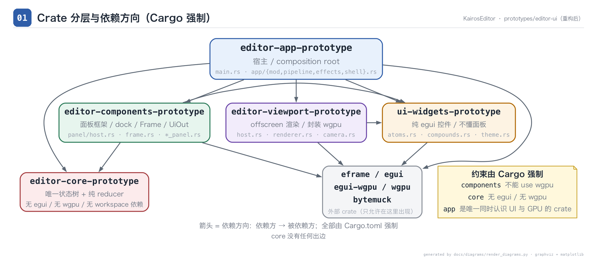
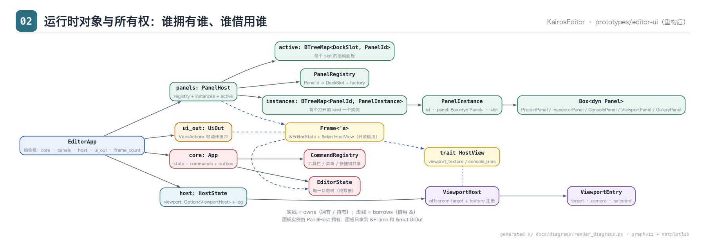
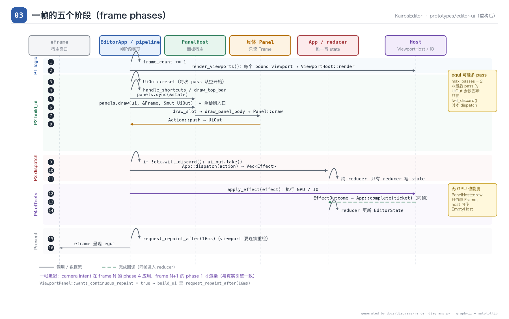
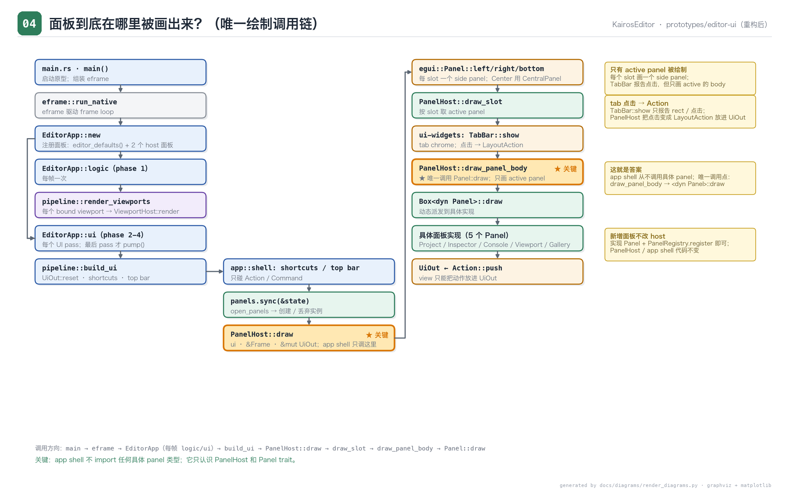
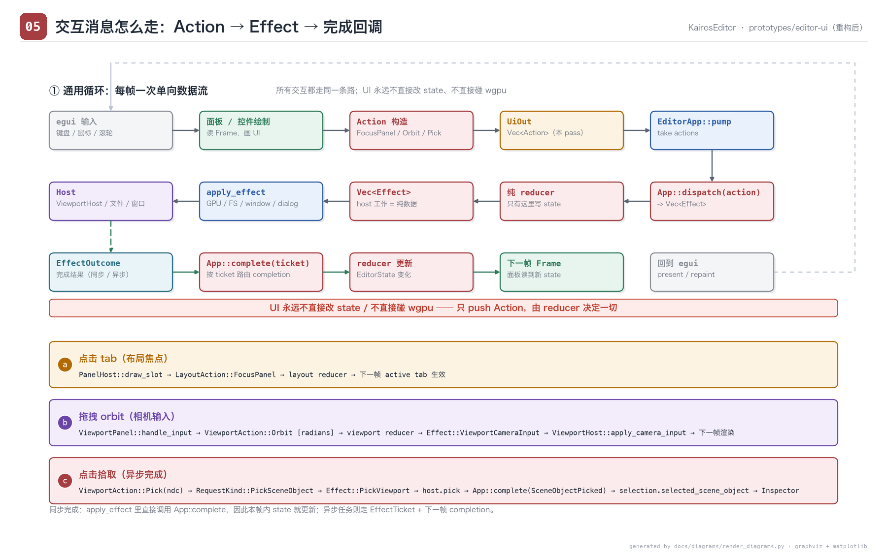
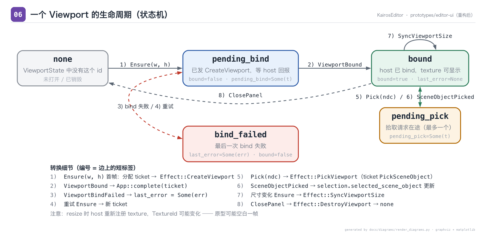
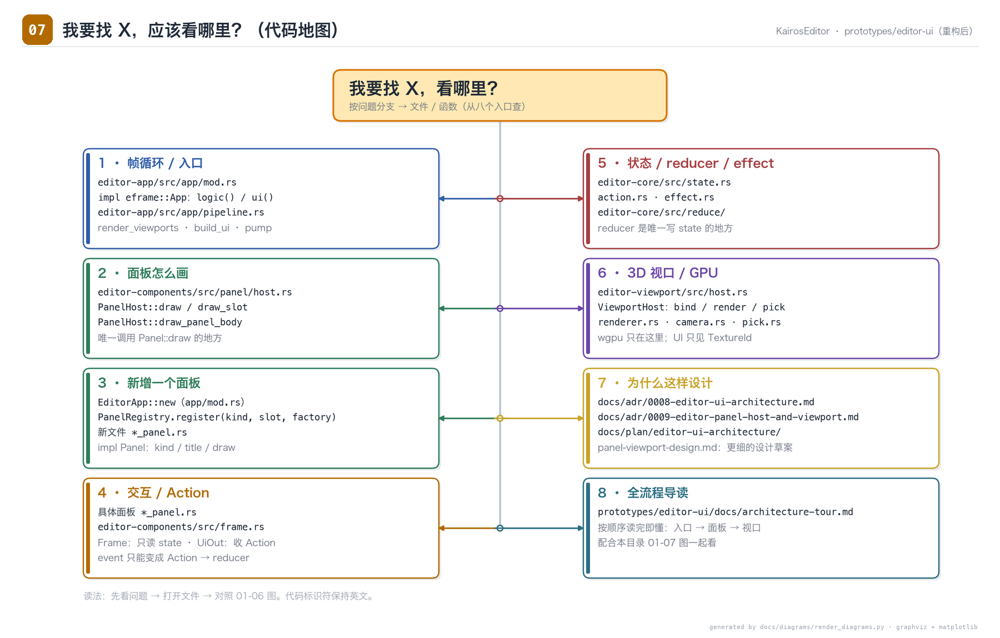

# 原型架构导读：一帧、一个面板、一条消息

> 面向：第一次读 `prototypes/editor-ui/` 的人；或准备把这里的分层/帧阶段搬进
> `kairos_editor_*` 的人。
>
> 这份原型很小，但代码形状按最终编辑器写。本文只回答三件事：
> **Panel 在哪里被画、UI 事件怎么变成状态、消息/资源怎么在 UI 与 host 之间流动。**
>
> 配套 7 张图在 [docs/diagrams/](diagrams/)（可用 `python3 docs/diagrams/render_diagrams.py` 重新生成）。
> 证据与测试清单在 [../README.md](../README.md)；生产映射在
> [panel-viewport-design.md](../../../docs/plan/editor-ui-architecture/panel-viewport-design.md) §6。

---

## 0. 先回答：Panel 到底在哪里被画？

**结论：架构方向是对的（单向数据流 + 分层 + 显式帧阶段），之前的痛苦主要来自“入口不显眼 + 文件职责混杂”，不是设计错误。** 这次重构把入口和文件边界摆到了台面上（§6）。

### 0.1 一张定位表（找代码先用它）

| 你想找的 | 看这里 | 说明 |
|---|---|---|
| 窗口/帧循环入口 | `editor-app/src/main.rs` → `app/mod.rs` 的 `impl eframe::App` | `logic()` 每帧一次；`ui()` 每 pass 一次 |
| 一帧里先做什么、后做什么 | `editor-app/src/app/pipeline.rs` | `render_viewports` → `build_ui` → `pump` |
| **面板绘制入口** | `editor-components/src/panel/host.rs` 的 `PanelHost::draw` | BuildUi 里每 pass 调一次；app shell 只调它 |
| **真正调用 `Panel::draw` 的地方** | 同文件 `PanelHost::draw_panel_body` | 整个生产路径**唯一**的 `instance.panel.draw(...)` |
| 具体面板怎么画 | `project_panel.rs` / `inspector_panel.rs` / `console_panel.rs` / `viewport_panel.rs` / `app/gallery.rs` | 每个都 `impl Panel`，只画 body |
| 面板怎么被创建/销毁 | `panel/host.rs::sync` + `panel/registry.rs::PanelRegistry` | open 集合 → 活实例；registry 提供 factory |
| 面板怎么注册 | `app/mod.rs::EditorApp::new` | 默认 3 个 + host 专属 2 个（Viewport/Gallery） |
| 点击/拖拽怎么变成状态 | 具体面板 → `UiOut` → `app/pipeline.rs::pump` → `App::dispatch` | UI 永远不直接改 `EditorState` |
| Action 怎么变成 IO/GPU | `app/effects.rs::apply_effect` | 唯一执行副作用的地方；completion 回 reducer |
| 3D 视口 GPU 在哪里 | `editor-viewport/src/host.rs::ViewportHost` | UI 只拿 `egui::TextureId`，看不到 wgpu |
| 领域状态/规则在哪里 | `editor-core/src/{state,action,effect}.rs` + `reduce/` | 纯数据 + 纯 reducer |

### 0.2 完整调用链（6 个函数 + 1 个 trait 方法）

```text
eframe 窗口/事件循环
  └─ impl eframe::App for EditorApp        (editor-app/src/app/mod.rs)
       ├─ logic()                         阶段 1，每帧一次
       │    └─ pipeline::render_viewports (app/pipeline.rs)
       │         └─ ViewportHost::render   (editor-viewport/src/host.rs)
       └─ ui()                            阶段 2-4，每 pass
            ├─ pipeline::build_ui          (app/pipeline.rs)
            │    ├─ shell::handle_shortcuts / draw_top_bar
            │    ├─ PanelHost::sync        (panel/host.rs)  open 集合 -> 活实例
            │    └─ PanelHost::draw        (panel/host.rs)  ★ 唯一的面板绘制入口
            │         └─ draw_slot         (panel/host.rs)  每个非空槽位
            │              ├─ TabBar::show (ui-widgets)     tab 外观/点击
            │              └─ draw_panel_body (panel/host.rs)
            │                   └─ Panel::draw (trait object)  ★ 唯一调用点
            │                        └─ ProjectPanel / InspectorPanel / ConsolePanel /
            │                           ViewportPanel / GalleryPanel
            └─ pipeline::pump              (app/pipeline.rs)  只在 !ctx.will_discard()
                 ├─ App::dispatch          (editor-core/src/lib.rs)
                 ├─ effects::apply_effect  (app/effects.rs)   IO / GPU / window
                 └─ App::complete          (editor-core/src/lib.rs)  completion -> reducer
```

**验证这一点最快的方法**：在 workspace 里搜生产代码对 `PanelHost::draw` 的调用，只有
`pipeline::build_ui` 一处；搜 `panel.draw(`，只有 `draw_panel_body` 一处。`EditorApp`
自身没有任何面板字段，也没有任何具体面板的 `draw` 调用。

---

## 1. 七张图与读图要点

### 图 1：crate 分层（什么能看见什么）



- 箭头 = Cargo 依赖，**不是建议，是编译期强制**。
- `editor-core` 零外部依赖：不依赖 egui/wgpu，所以状态与 reducer 能 headless 测试。
- `editor-components` 依赖 core + widgets + egui，但**不能**依赖 `editor-viewport`/wgpu：面板只能通过
  `Frame::host: &dyn HostView` 拿 `TextureId`。
- `editor-viewport` 依赖 egui/egui-wgpu/wgpu，但**不能**依赖 core/components/app：host 侧不需要知道 UI 状态。
- `editor-app` 是唯一同时看见两端的 crate：它把 UI 的 `Effect` 翻译成 GPU/IO 调用，再把结果回填。

### 图 2：运行时对象与所有权（谁拥有什么）



- `EditorApp` 拥有四类东西：`core: App`（状态 + reducer + effect outbox）、`panels: PanelHost`、
  `host: HostState`（wgpu viewport + log）、`ui_out: UiOut`（帧级 action 缓冲）。
- `PanelHost` 拥有 `PanelRegistry` 和 `BTreeMap<PanelId, PanelInstance>`；`PanelInstance` 里是
  `Box<dyn Panel>`，所以加面板不改 `EditorApp` 字段。
- `Frame` 是**借用视图**（`&EditorState` + `&dyn HostView`），不是快照拷贝；`UiOut` 是唯一写回通道。
- 相机/GPU 资源在 `HostState → ViewportHost`；`EditorState.viewports` 只存 size/bound/pending 这些
  “意图与登记”，避免双真值。

### 图 3：一帧的阶段与多 pass（时序图）



读图注意三个点：

1. `logic` 每帧恰好一次，在**所有 UI pass 之前**；`ui` 可能跑 1~2 次（egui 0.35 的
   `max_passes = 2`）。
2. 每个 pass 开始都 `UiOut::new()` 清空；只有最后一个 pass（`!ctx.will_discard()`）才 `pump`，
   所以多 pass 不会重复 dispatch/重复发 effect。
3. 相机 intent 在本帧末尾才应用到 host camera，**下一帧的 `render_viewports` 才渲染它**；因此
   输入到画面固定延迟 1 帧（与真实引擎 `Engine::update` 在 UI 之前的语义一致，不是巧合）。

### 图 4：面板绘制精确调用图（本导读的重点）



这张图回答“为什么我找不到画 Panel 的地方”：

- 入口叫 `PanelHost::draw`（之前叫 `show`，名字看起来像“显示 host”，不表达“绘制面板”）；
- 中间经过 `draw_slot`（负责 tab bar + 选 active panel）才到 `draw_panel_body`；
- `Panel::draw` 是 **trait 动态分发**：在源码里 grep `Panel::draw` 只能找到 trait 定义和
  `draw_panel_body` 的 `instance.panel.draw(...)`，具体实现散落在各 `*_panel.rs`；
- 每个 slot 只画 active 面板；非 active 实例保留 view state，但不画（docking 语义）。

### 图 5：UI 交互与消息传递（时序图）



三个通道，方向不要混：

| 通道 | 方向 | 载体 | 谁处理 |
|---|---|---|---|
| UI → core | 用户意图 | `UiOut { Vec<Action> }` | `pump` → `App::dispatch` |
| core → host | 副作用请求 | `Vec<Effect>`（dispatch 返回值） | `effects::apply_effect` |
| host → core | 异步/GPU 完成 | `App::complete(ticket, EffectOutcome)` | ticket 校验后进 reducer |
| host → UI | 只读资源 | `Frame::host`（`HostView`：TextureId/log） | 面板每帧读取 |

三条硬规则：

1. **UI 不写状态**：面板只能 `out.push(Action)`；`EditorState` 只有 reducer 能 `&mut`。
2. **effect 不直接改状态**：host 执行完用 `EffectOutcome` + ticket 回来，reducer 决定接不接受
   （stale ticket 直接丢弃）。
3. **UI 不碰 wgpu**：面板只拿 `TextureId` 画 `painter.image`；相机/拾取/纹理生命周期在 host。

图里的四条典型交互：

| 交互 | Action | reducer 产出 | 结果 |
|---|---|---|---|
| 点 tab / 关闭 | `LayoutAction::FocusPanel/ClosePanel` | （无 effect） | 下一帧 active 变化；关闭 Viewport 会发 `DestroyViewport` |
| 顶栏按钮 / Cmd+S | 由 `CommandRegistry` 解析成 `Action` | `Effect::SaveDocument/...` | host 写文件 → completion → dirty 清掉 |
| 视口拖拽 | `ViewportAction::Orbit{radians}` / `Pan` / `Zoom` | `Effect::ViewportCameraInput` | host 相机应用 → 下一帧渲染 |
| 视口单击 | `ViewportAction::Pick{ndc}` | `Effect::PickViewport` | host raycast → `SceneObjectPicked` → selection |

### 图 6：Viewport 生命周期状态机



- 首次可见时面板上报物理像素 → `Ensure` → reducer 建 `ViewportInfo` + ticket，发 `CreateViewport`；
- bind 完成前 resize 会被 reducer 记住，`ViewportBound` 后 replay（`SyncViewportSize`）；
- 只有 `bound` 后才转发 camera/pick；
- 关闭面板 → `ClosePanel` → reducer 移除 viewport 并 `DestroyViewport`；重开是新 ticket；
- 原型用持久 target，但 resize 会 free + 重新注册，`TextureId` 会变，因此可能闪一帧空白
  （README §8 已列为生产要修的点）。

### 图 7：代码地图（按问题找文件）



和 §0.1 的表等价；图适合贴在看板/文档里，表适合直接跳转。

---

## 2. 一帧的生命周期（把图 3 展开成文字）

```text
帧 N
├─ [logic]  frame_count += 1
│           render_viewports()
│             对 ViewportState 里每个 bound 视口：set_selected + render（提交 GPU，不等）
├─ [ui pass 1]
│           ui_out = 空
│           handle_shortcuts（Cmd+S/Z/G 等 push Action）
│           draw_top_bar（按钮/命令 -> Action）
│           panels.sync(&state)      // 只创建/删除实例
│           panels.draw(ui, Frame, &mut ui_out)
│           draw_modal
│           // 内部：draw_slot -> TabBar + draw_panel_body -> Panel::draw
├─ [ui pass 2..n]  若 egui 请求 discard，重复上面（ui_out 重新清空）
├─ [最后一 pass 末尾]
│           actions = ui_out.take()
│           dispatch 每个 action -> Vec<Effect>
│           apply_effect 循环（IO/GPU，可返回更多 Effect；budget 64）
│           completion 立即 App::complete -> reducer -> 新 state
└─ present（eframe/egui 合成；viewport 纹理已经被 egui 采样）
帧 N+1
└─ render_viewports 用帧 N 应用后的 camera 渲染 -> present 看到变化
```

## 3. 面板框架对象模型（把图 2/4 展开）

| 类型 | 职责 | 关键约束 |
|---|---|---|
| `Panel` trait | 画 body、给 title、报 closable/repaint | 只读 `&Frame`、只写 `&mut UiOut`；不碰 store/IO |
| `PanelRegistry` | `PanelId → (DockSlot, factory)` | 启动期注册；未知 id 返回 `None`，host 忽略而不是 panic |
| `PanelHost` | 实例生命周期 + 四槽 dock + tab bar + 绘制分发 | `sync` 幂等；`draw` 不创建/删除实例；只画 active body |
| `PanelHostOutput` | 绘制报告（active 面板、rect、tab/close rect、repaint 聚合） | 给测试/浮层锚定用；生产绘制不回读 |
| `Frame<'a>` | 一帧的只读快照：`&EditorState` + `&dyn HostView` | `Copy`；不拥有任何东西 |
| `UiOut` | 帧级 action buffer | 每 pass 清空；只有最后一 pass 被 drain |
| `PanelId` / `PanelInstanceId` | 面板 kind / 实例身份 | 字符串是数据，不是封闭 enum；加面板不改 core |

**为什么这样设计**（也是给生产的理由）：面板是**可插拔功能**，不是 `EditorApp` 的字段；`PanelId`
是数据所以布局能持久化、能被 MCP/命令寻址；host 拥有实例所以打开/关闭/焦点只是 `LayoutState`
的纯数据变化，reducer 不需要认识具体面板类型。

## 4. 视口：egui 与 wgpu 的接缝（把图 6 展开）

### 4.1 渲染路径

```text
host（生产：引擎 RenderViewports；原型：ViewportHost）
  wgpu render pass -> offscreen Rgba8UnormSrgb texture
  register_native_texture -> egui::TextureId
        │
        ▼
PanelHost::draw_panel_body -> ViewportPanel::draw
  ui.painter().image(texture_id, rect, uv, WHITE)
        │
        ▼
egui 合成 pass（生产：同一个 render graph 的 egui pass）
```

### 4.2 输入路径（面板只产生 camera-ready 单位）

| 手势 | 面板换算 | Action | host 执行 |
|---|---|---|---|
| 左键拖 | `[-dx*0.008, +dy*0.008]` | `Orbit{radians}` | 相机 yaw/pitch |
| 中键/Shift+左键拖 | `[dx/H, dy/H]` 归一化视口高 | `Pan` | 相机目标平面平移 |
| 滚轮 | `scroll * 1/500` | `Zoom`（正=拉近） | 乘性距离 |
| 左键单击 | rect → NDC（y 翻转） | `Pick{ndc}` | NDC→ray→命中对象 id |

面板不做相机数学、不读相机状态：它只把 egui 输入翻译成**与 egui 无关的意图**。这是为了生产里
同一套 `CameraInput` 能喂给 `EditorCameraController`。

### 4.3 为什么是 RTT，而不是 `egui_wgpu::CallbackTrait`

引擎的 egui 合成 pass 没有 depth、UI crate 拿不到 wgpu device、render graph 的 pass 顺序不能由
“面板在哪一帧声明 callback”决定；RTT 把“渲染”留在 host/引擎，UI 只采样纹理，边界稳定。

## 5. 新增一个面板 / 一个视口要改什么

新增面板（例如 Game view）：

1. 新建 `game_panel.rs`：`impl Panel`（`kind()` 返回 `PanelId("game")`，`draw` 只画 body，交互
   `out.push(Action::...)`）。
2. 在 `EditorApp::new` 里 `registry.register(PanelId("game"), DockSlot::Center, ...)`。
3. 需要打开它：`LayoutAction::TogglePanel { panel: PanelId("game") }`（菜单/命令/快捷键任选）。

**不需要**改 `editor-core`、`EditorApp` 字段、`PanelHost` 或 `Panel` trait。

新增一个视口：

1. core 里 `ViewportId(2)` + 一个面板（或同面板的多实例）在可见时发 `Ensure`；
2. host 的 `ViewportHost` 按 key 自动建 target；`render_viewports` 遍历所有 bound 视口，不认面板；
3. 多实例 docking 需要把 `LayoutState` 的 open 集合升级成 `PanelInstanceId`（设计见 §2.8），
   trait/host/tab-bar API 不变。

## 6. 这次重构改了什么（以及为什么这是“可读性”而不是“换架构”）

| 之前 | 现在 | 原因 |
|---|---|---|
| `panel.rs` 585 行混 trait/ids/registry/host/输出 | `panel/{mod,registry,host}.rs` | 一个文件 5 个概念，扫不到“入口” |
| `PanelHost::show` | `PanelHost::draw`（doc 明确 single drawing entry） | 名字不表达“画”，与 `TabBar::show`/widget show 混淆 |
| `sync(&LayoutState, &EditorState)` | `sync(&EditorState)` | layout 本来就在 state 里，重复传参让调用点难读 |
| `app.rs` 605 行混 struct/new/帧阶段/effect/shell/seed | `app/{mod,pipeline,effects,shell,seed}.rs`；`impl eframe::App` 在 mod.rs 前部 | 帧入口应该第一眼看到；effect/shell 是不同职责 |
| `render_viewports` 硬编码 `PanelId::VIEWPORT` + `ViewportId::SCENE` | 遍历 `ViewportState` 所有 bound 视口 | app 不该认识具体面板/视口；多视口应是数据 |
| `build_ui` 末尾再写一遍 repaint 条件 | 只保留 `PanelHostOutput.wants_continuous_repaint` | 同一策略两处实现 |
| app 重复注册 Project/Inspector/Console | 直接用 `PanelRegistry::editor_defaults()` | 组合根只加 host 专属面板 |
| 文档里大量 `panel.rs:285-585` 行号 | 改为模块/符号引用 | 行号每次重构都失效 |

**没有改**：数据流、分层、帧阶段、trait/registry/host 的职责、所有 Action/Effect 词表、测试语义。
`cargo test` 现为 127 个（126 headless + 1 doctest），0 warning（新增 1 个 dock viewer 适配测试）。

## 7. 建议的读代码顺序

1. `main.rs`（30 行）→ `app/mod.rs` 顶部注释 + `impl eframe::App`（一屏看完帧入口）。
2. `app/pipeline.rs`：`render_viewports` / `build_ui` / `pump`（一屏看完一帧）。
3. `panel/mod.rs` 顶部注释 + `host.rs` 的 `draw` 调用链（本导读 §0.2 的代码版）。
4. 选一条链路读到底，例如 viewport：
   `viewport_panel.rs` → `UiOut` → `pump` → `reduce/viewport.rs` → `effects.rs::apply_effect`
   → `editor-viewport/src/host.rs` → 回 `Frame`。
5. 再看 `frame.rs`（View/UiOut/HostView 三个类型）与 `editor-core` 的 action/effect 词表。
6. 最后读 [ADR 0009](../../../docs/adr/0009-editor-panel-host-and-viewport.md) 与
   [panel-viewport-design.md](../../../docs/plan/editor-ui-architecture/panel-viewport-design.md) §6（生产映射）。

## 8. 与生产 crate 的映射（速查）

| 原型 | 生产目标 | 迁移要点 |
|---|---|---|
| `editor-core` | `kairos_editor_core` | 基本照搬；`DocumentAction::Open` 的 content 改异步 LoadDocument |
| `editor-components` | `kairos_editor_component` | `Panel` 形状不变（改成收 `&mut EditorState` 的 `PanelContext`）；`Frame`/`UiOut` 不迁；面板/关闭已接 `kairos_editor_docking` |
| `ui-widgets` | `kairos_editor_widgets` | 纯 egui 组件直接搬 |
| `editor-viewport` | `kairos_editor_app` 的 viewport host 模块 | `ViewportHost` 换成 `RenderViewports` + `bind_attachment_to_egui` |
| `editor-app` | `kairos_editor_app` | eframe 只留原型；生产接管 winit/wgpu + `RenderPipeline::present` |
| 四槽 `PanelHost` | `kairos_editor_docking` | `DockSlot` 替身为 dock 树；`PanelInstanceId` 多实例 |

详见 design doc §6 的 P1-P5 迁移步骤与 panel-viewport-design §7.4 的 9 条原型↔生产差异。

---

## 9. 生产同步（2026-11-12）：docking viewer seam

> 生产侧把 docking 重构为「布局数据 + viewer」，并把 `PanelHost` 改成实现 dock 的
> `TabViewer`。原型同步了 `Panel` trait 的关闭/浮动窗口/滚动条/rect 默认方法；四槽
> `PanelHost` 仍然是原型的最小替身。本节是「照着原型实现生产」时的差异清单。

### 9.1 生产调用链

```text
EditorApp::draw
  -> LayoutState (open/focus 意图)
  -> DockState<PanelInstanceId>          (布局真值：id / split / tab order，可序列化)
  -> Docker::show(ui, &mut PanelHostViewer)
       -> PanelHostViewer implements TabViewer
       -> PanelHostViewer::ui(id) -> PanelHost.instances[id].draw(ui, &mut PanelContext)
  <- 关闭/焦点：closeable / on_close / allowed_in_windows 回调
```

对应生产文件：

| 生产文件 | 职责 |
|---|---|
| `kairos_editor_docking/src/viewer.rs` | `TabId` / `TabViewer` / `CloseResponse`（dock 唯一扩展点） |
| `kairos_editor_docking/src/docker.rs` | `DockState<Id>`（只存布局）+ `Docker::show` 单入口 + 浮动窗口 chrome |
| `kairos_editor_app/src/panel.rs` | `Panel` / `PanelInstanceId` / `PanelRegistry` / `PanelHost`（实现 `TabViewer`） |
| `kairos_editor_app/src/app.rs` | 组合根：`host.sync -> dock reconcile -> Docker::show -> focus` |
| 原型 `editor-components/src/panel/viewer.rs` | 同形状 `DockViewer` / `PanelHostViewer`（Frame/UiOut 版），验证 id→panel 解析与 close 回调；生产实现换成 `TabViewer` + `PanelContext` |

### 9.2 原型 → 生产的差异

| 关注点 | 原型（`prototypes/editor-ui`） | 生产（2026-11-12） |
|---|---|---|
| 面板 trait | `Panel` + `Frame` + `UiOut` | `Panel` + `PanelContext { state: &mut EditorState }`；仍然只有 `Panel` 一套 trait |
| 面板实例归属 | `PanelHost`（`BTreeMap<PanelId, ...>`） | `PanelHost`（`BTreeMap<PanelInstanceId, ...>`），并实现 `TabViewer` |
| 布局真值 | `LayoutState.open/focus` + 四槽固定 | `LayoutState.open/focus` + `DockState<PanelInstanceId>`（dock 树/顺序/比例在 app 侧可序列化） |
| 绘制入口 | `PanelHost::draw -> draw_slot -> Panel::draw` | `Docker::show -> PanelHostViewer::ui -> Panel::ui` |
| 关闭/浮动 | tab 点击 push Action；host 决定 close | 先经 `closeable/on_close/allowed_in_windows`，viewer 把意图交给 app，再 `host.sync` 收敛 |
| 浮动窗口 | 无（四槽固定） | 每个 window surface 有独立标题栏（关闭/最小化/最大化）和 tab 内容 |
| 面板默认方法 | `closable/wants_continuous_repaint/on_close/allowed_in_windows/scroll_bars/on_rect_changed` | 同左 + `context_menu` 等 viewer 钩子；本版原型已补关闭/浮动/滚动/rect 默认方法 |

### 9.3 照原型写生产时的规则

1. **不要引入第二个 `Tab` trait**。docking crate 只定义 `TabViewer`；面板仍然实现 `Panel`，
   `PanelHost` 是 viewer 的实现者。`kairos_editor_docking` 不依赖 `editor-core`/`editor-ui`。
2. `PanelHost` 的 id 是 `PanelInstanceId`；`DockState<PanelInstanceId>` 只存 id，不存
   `Box<dyn Panel>`——这是「布局可序列化」和「core/MCP 可寻址布局」的前提。
3. 打开/关闭/焦点先改 `LayoutState`；每帧 `host.sync(&state)` 创建/销毁实例，dock 侧只做
   tab 增删/对齐，不在 dock 内部改 app 的 open/focus 真值。
4. 原型用 `Frame`（只读）+ `UiOut`（Action 缓冲）作为 headless 边界；生产 owner 决定
   **不建 headless core**，所以 `PanelContext` 直接给 `&mut EditorState`。迁移面板代码时保持
   `Panel` 方法语义不变，只替换上下文类型；复杂命令仍可沿用原型的 Action/Effect 词表。
5. 视觉（tab 分隔线/拖拽窗口浮层/浮动窗口 Unity 标题栏）只在 `kairos_editor_docking`，
   原型四槽不为了视觉同步而改；原型证明的是面板 API 和帧阶段，不是最终视觉效果。

详见 [panel-viewport-design.md](../../../docs/plan/editor-ui-architecture/panel-viewport-design.md) §6 的 P1-P5。
